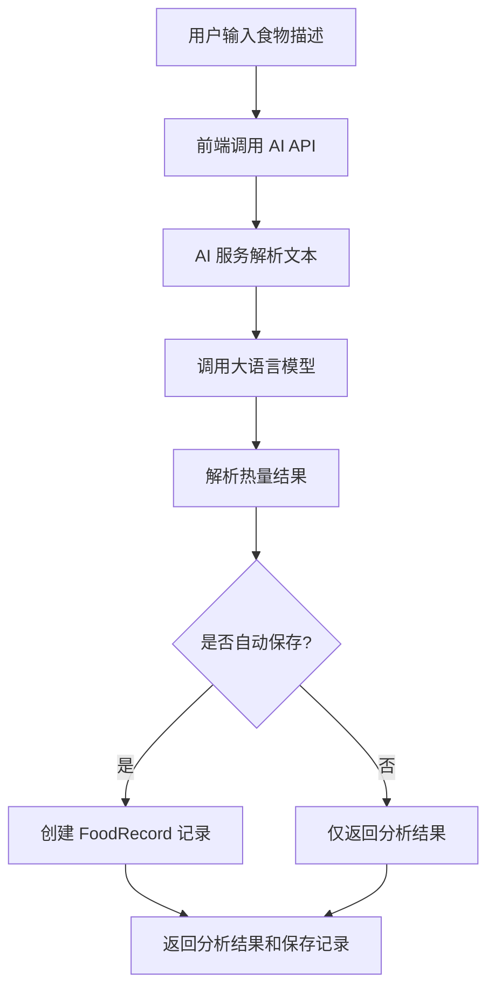
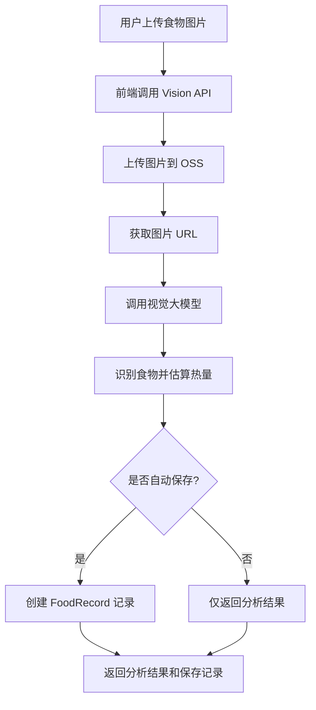

# Just Go! 后端 API 文档

## 目录
1. [基础信息](#基础信息)
2. [认证相关 API](#认证相关-api)
3. [用户相关 API](#用户相关-api)
4. [记录相关 API](#记录相关-api)
5. [AI 智能分析 API](#ai-智能分析-api)
6. [视觉图片分析 API](#视觉图片分析-api)
7. [数据模型](#数据模型)

---

## 基础信息

### 服务器地址
- **开发环境**: `http://localhost:3000`
- **生产环境**: 根据部署配置

### 通用响应格式

#### 成功响应
```json
{
  "success": true,
  "message": "操作成功",
  "data": { }
}
```

#### 失败响应
```json
{
  "success": false,
  "message": "错误信息描述"
}
```

### 认证方式
需要认证的接口需要在请求头中携带 JWT Token：
```
Authorization: Bearer <your-token-here>
```

---

## 认证相关 API

### 1. 用户注册

**接口地址**: `POST /api/auth/register`

**请求参数**:
```json
{
  "phone": "13800138000",
  "password": "123456"
}
```

| 参数 | 类型 | 必填 | 说明 |
|------|------|------|------|
| phone | string | 是 | 11位手机号 |
| password | string | 是 | 密码，至少6个字符 |

**成功响应** (201):
```json
{
  "success": true,
  "message": "注册成功",
  "data": {
    "token": "eyJhbGciOiJIUzI1NiIsInR5cCI6IkpXVCJ9...",
    "user": {
      "id": "507f1f77bcf86cd799439011",
      "phone": "13800138000",
      "name": "13800138000",
      "avatar": "https://images.unsplash.com/photo-1535713875002-d1d0cf377fde?auto=format&fit=crop&w=100&q=80",
      "bodyStats": {
        "height": 170,
        "weight": 65,
        "age": 25,
        "gender": "male"
      },
      "goals": {
        "dailyCalorie": 1500,
        "dailyExercise": 45,
        "weeklyDays": 5
      },
      "streakDays": 0
    }
  }
}
```

**失败响应**:
- 400: 请填写完整信息
- 400: 请输入正确的手机号
- 400: 密码至少6个字符
- 400: 该手机号已注册

---

### 2. 用户登录

**接口地址**: `POST /api/auth/login`

**请求参数**:
```json
{
  "phone": "13800138000",
  "password": "123456"
}
```

| 参数 | 类型 | 必填 | 说明 |
|------|------|------|------|
| phone | string | 是 | 11位手机号 |
| password | string | 是 | 用户密码 |

**成功响应** (200):
```json
{
  "success": true,
  "message": "登录成功",
  "data": {
    "token": "eyJhbGciOiJIUzI1NiIsInR5cCI6IkpXVCJ9...",
    "user": {
      "id": "507f1f77bcf86cd799439011",
      "phone": "13800138000",
      "name": "Terry",
      "avatar": "https://images.unsplash.com/photo-1535713875002-d1d0cf377fde?auto=format&fit=crop&w=100&q=80",
      "bodyStats": {
        "height": 175,
        "weight": 70,
        "age": 25,
        "gender": "male"
      },
      "goals": {
        "dailyCalorie": 1500,
        "dailyExercise": 45,
        "weeklyDays": 5
      },
      "streakDays": 12
    }
  }
}
```

**失败响应**:
- 400: 请填写完整信息
- 401: 账号或密码错误

---

## 用户相关 API

### 3. 获取当前用户信息

**接口地址**: `GET /api/user/profile`

**需要认证**: 是

**成功响应** (200):
```json
{
  "success": true,
  "data": {
    "user": {
      "id": "507f1f77bcf86cd799439011",
      "phone": "13800138000",
      "name": "Terry",
      "avatar": "https://images.unsplash.com/...",
      "bodyStats": {
        "height": 175,
        "weight": 70,
        "age": 25,
        "gender": "male"
      },
      "goals": {
        "dailyCalorie": 1500,
        "dailyExercise": 45,
        "weeklyDays": 5
      },
      "streakDays": 12,
      "lastCheckIn": "2024-12-17T10:30:00.000Z",
      "createdAt": "2024-12-01T08:00:00.000Z"
    }
  }
}
```

**失败响应**:
- 401: 未授权，请先登录
- 401: Token 无效或已过期

---

### 4. 更新用户基本信息

**接口地址**: `PUT /api/user/profile`

**需要认证**: 是

**请求参数**:
```json
{
  "name": "Terry",
  "avatar": "https://example.com/avatar.jpg"
}
```

| 参数 | 类型 | 必填 | 说明 |
|------|------|------|------|
| name | string | 否 | 用户昵称 |
| avatar | string | 否 | 头像URL |

**成功响应** (200):
```json
{
  "success": true,
  "message": "信息更新成功",
  "data": {
    "user": {
      "id": "507f1f77bcf86cd799439011",
      "phone": "13800138000",
      "name": "Terry",
      "avatar": "https://example.com/avatar.jpg",
      "bodyStats": { },
      "goals": { },
      "streakDays": 12
    }
  }
}
```

---

### 5. 更新身体数据

**接口地址**: `PUT /api/user/body-stats`

**需要认证**: 是

**请求参数**:
```json
{
  "height": 175,
  "weight": 70,
  "age": 25,
  "gender": "male"
}
```

| 参数 | 类型 | 必填 | 说明 |
|------|------|------|------|
| height | number | 否 | 身高(cm) |
| weight | number | 否 | 体重(kg) |
| age | number | 否 | 年龄 |
| gender | string | 否 | 性别 (male/female) |

**成功响应** (200):
```json
{
  "success": true,
  "message": "身体数据更新成功",
  "data": {
    "bodyStats": {
      "height": 175,
      "weight": 70,
      "age": 25,
      "gender": "male"
    },
    "bmr": 1680
  }
}
```

---

### 6. 更新目标设置

**接口地址**: `PUT /api/user/goals`

**需要认证**: 是

**请求参数**:
```json
{
  "dailyCalorie": 1500,
  "dailyExercise": 45,
  "weeklyDays": 5
}
```

| 参数 | 类型 | 必填 | 说明 |
|------|------|------|------|
| dailyCalorie | number | 否 | 每日热量目标(kcal) |
| dailyExercise | number | 否 | 每日运动时长目标(分钟) |
| weeklyDays | number | 否 | 每周运动天数目标(1-7) |

**成功响应** (200):
```json
{
  "success": true,
  "message": "目标设置更新成功",
  "data": {
    "goals": {
      "dailyCalorie": 1500,
      "dailyExercise": 45,
      "weeklyDays": 5
    }
  }
}
```

---

### 7. 用户签到

**接口地址**: `POST /api/user/check-in`

**需要认证**: 是

**成功响应** (200):
```json
{
  "success": true,
  "message": "签到成功",
  "data": {
    "streakDays": 13
  }
}
```

**失败响应**:
- 400: 今天已经签到过了

---

### 8. 获取基础代谢率

**接口地址**: `GET /api/user/bmr`

**需要认证**: 是

**成功响应** (200):
```json
{
  "success": true,
  "data": {
    "bmr": 1680,
    "bodyStats": {
      "height": 175,
      "weight": 70,
      "age": 25,
      "gender": "male"
    }
  }
}
```

---

## 记录相关 API

### 9. 获取所有记录

**接口地址**: `GET /api/records`

**需要认证**: 是

**查询参数**:
| 参数 | 类型 | 必填 | 说明 |
|------|------|------|------|
| type | string | 否 | 记录类型 (intake/consume) |
| limit | number | 否 | 每页数量，默认50 |
| page | number | 否 | 页码，默认1 |

**请求示例**:
```
GET /api/records?type=consume&limit=20&page=1
```

**成功响应** (200):
```json
{
  "success": true,
  "data": {
    "records": [
      {
        "_id": "507f1f77bcf86cd799439011",
        "user": "507f1f77bcf86cd799439012",
        "name": "晨跑",
        "type": "consume",
        "calories": 250,
        "duration": 30,
        "distance": 5.0,
        "exerciseType": "run",
        "preferences": ["🏞️ Citywalk", "🌳 绿化多"],
        "time": "2024-12-17T06:30:00.000Z",
        "createdAt": "2024-12-17T06:30:00.000Z"
      },
      {
        "_id": "507f1f77bcf86cd799439013",
        "user": "507f1f77bcf86cd799439012",
        "name": "拿铁咖啡",
        "type": "intake",
        "calories": 180,
        "duration": 0,
        "distance": 0,
        "exerciseType": "other",
        "preferences": [],
        "time": "2024-12-17T08:00:00.000Z",
        "createdAt": "2024-12-17T08:00:00.000Z"
      }
    ],
    "pagination": {
      "page": 1,
      "limit": 20,
      "total": 45
    }
  }
}
```

---

### 10. 获取今日记录

**接口地址**: `GET /api/records/today`

**需要认证**: 是

**成功响应** (200):
```json
{
  "success": true,
  "data": {
    "records": [
      {
        "_id": "507f1f77bcf86cd799439011",
        "name": "晨跑",
        "type": "consume",
        "calories": 250,
        "duration": 30,
        "distance": 5.0,
        "exerciseType": "run",
        "time": "2024-12-17T06:30:00.000Z"
      }
    ]
  }
}
```

---

### 11. 获取今日统计

**接口地址**: `GET /api/records/today/stats`

**需要认证**: 是

**成功响应** (200):
```json
{
  "success": true,
  "data": {
    "intake": 850,
    "consume": 1300,
    "base": 1600,
    "net": -1050,
    "recordCount": 8
  }
}
```

| 字段 | 说明 |
|------|------|
| intake | 今日摄入热量(kcal) |
| consume | 今日运动消耗(kcal) |
| base | 基础代谢率(kcal) |
| net | 净消耗 = 摄入 - 消耗 - 基础 |
| recordCount | 今日记录数 |

---

### 12. 创建新记录

**接口地址**: `POST /api/records`

**需要认证**: 是

**请求参数 (摄入记录)**:
```json
{
  "name": "午餐",
  "type": "intake",
  "calories": 650
}
```

**请求参数 (消耗记录)**:
```json
{
  "name": "跑步运动",
  "type": "consume",
  "calories": 350,
  "duration": 35,
  "distance": 5.5,
  "exerciseType": "run",
  "preferences": ["🏞️ Citywalk", "🌳 绿化多"]
}
```

| 参数 | 类型 | 必填 | 说明 |
|------|------|------|------|
| name | string | 是 | 记录名称 |
| type | string | 是 | 记录类型 (intake/consume) |
| calories | number | 是 | 卡路里数 |
| duration | number | 否 | 运动时长(分钟)，仅运动记录 |
| distance | number | 否 | 运动距离(km)，仅运动记录 |
| exerciseType | string | 否 | 运动类型 (walk/run/bike/other) |
| preferences | array | 否 | 路线偏好标签数组 |

**成功响应** (201):
```json
{
  "success": true,
  "message": "记录创建成功",
  "data": {
    "record": {
      "_id": "507f1f77bcf86cd799439011",
      "user": "507f1f77bcf86cd799439012",
      "name": "跑步运动",
      "type": "consume",
      "calories": 350,
      "duration": 35,
      "distance": 5.5,
      "exerciseType": "run",
      "preferences": ["🏞️ Citywalk", "🌳 绿化多"],
      "time": "2024-12-17T10:30:00.000Z",
      "createdAt": "2024-12-17T10:30:00.000Z"
    }
  }
}
```

**失败响应**:
- 400: 请填写完整信息
- 400: 类型必须是 intake 或 consume

---

### 13. 更新记录

**接口地址**: `PUT /api/records/:id`

**需要认证**: 是

**路径参数**:
| 参数 | 说明 |
|------|------|
| id | 记录ID |

**请求参数**:
```json
{
  "name": "下午茶",
  "calories": 200,
  "duration": 0,
  "distance": 0
}
```

| 参数 | 类型 | 必填 | 说明 |
|------|------|------|------|
| name | string | 否 | 记录名称 |
| calories | number | 否 | 卡路里数 |
| duration | number | 否 | 运动时长 |
| distance | number | 否 | 运动距离 |
| preferences | array | 否 | 路线偏好 |

**成功响应** (200):
```json
{
  "success": true,
  "message": "记录更新成功",
  "data": {
    "record": {
      "_id": "507f1f77bcf86cd799439011",
      "name": "下午茶",
      "type": "intake",
      "calories": 200,
      "time": "2024-12-17T14:30:00.000Z"
    }
  }
}
```

**失败响应**:
- 404: 记录不存在
- 403: 无权限更新此记录

---

### 14. 删除记录

**接口地址**: `DELETE /api/records/:id`

**需要认证**: 是

**路径参数**:
| 参数 | 说明 |
|------|------|
| id | 记录ID |

**成功响应** (200):
```json
{
  "success": true,
  "message": "记录删除成功"
}
```

**失败响应**:
- 404: 记录不存在
- 403: 无权限删除此记录

---

## AI 智能分析 API

> 这部分 API 提供基于大语言模型的智能热量分析功能，支持自然语言输入。

### 15. 食物热量分析（并自动保存）

**接口地址**: `POST /api/ai/analyze-food`

**需要认证**: 是

**功能说明**: 用户输入自然语言描述吃了什么，AI 自动分析每种食物的热量，并自动创建记录保存到数据库。

**请求参数**:
```json
{
  "text": "我今天早上吃了一个包子和鸡蛋",
  "autoSave": true
}
```

| 参数 | 类型 | 必填 | 说明 |
|------|------|------|------|
| text | string | 是 | 食物描述文本，支持自然语言 |
| autoSave | boolean | 否 | 是否自动保存记录，默认 true |

**成功响应** (200):
```json
{
  "success": true,
  "message": "食物热量分析成功",
  "data": {
    "analysis": {
      "success": true,
      "foods": [
        {
          "name": "包子",
          "quantity": "1个",
          "calories": 220,
          "unit": "个"
        },
        {
          "name": "鸡蛋",
          "quantity": "1个",
          "calories": 78,
          "unit": "个"
        }
      ],
      "totalCalories": 298,
      "summary": "这是一份较为均衡的早餐，蛋白质和碳水化合物配比适中。"
    },
    "savedRecords": [
      {
        "_id": "507f1f77bcf86cd799439011",
        "name": "包子 (1个)",
        "type": "intake",
        "calories": 220,
        "time": "2024-12-17T08:00:00.000Z"
      },
      {
        "_id": "507f1f77bcf86cd799439012",
        "name": "鸡蛋 (1个)",
        "type": "intake",
        "calories": 78,
        "time": "2024-12-17T08:00:00.000Z"
      }
    ],
    "totalCalories": 298,
    "summary": "这是一份较为均衡的早餐，蛋白质和碳水化合物配比适中。"
  }
}
```

**失败响应**:
- 400: 请输入食物描述
- 401: 未授权，请先登录
- 500: AI 分析失败 / 服务器错误

---

### 16. 运动消耗分析（并自动保存）

**接口地址**: `POST /api/ai/analyze-exercise`

**需要认证**: 是

**功能说明**: 用户输入自然语言描述做了什么运动，AI 自动分析运动消耗的热量，并自动创建记录保存到数据库。

**请求参数**:
```json
{
  "text": "我跑步了5公里，用时30分钟",
  "autoSave": true
}
```

| 参数 | 类型 | 必填 | 说明 |
|------|------|------|------|
| text | string | 是 | 运动描述文本，支持自然语言 |
| autoSave | boolean | 否 | 是否自动保存记录，默认 true |

**成功响应** (200):
```json
{
  "success": true,
  "message": "运动消耗分析成功",
  "data": {
    "analysis": {
      "success": true,
      "exercises": [
        {
          "name": "跑步",
          "duration": 30,
          "distance": 5,
          "calories": 350,
          "exerciseType": "run"
        }
      ],
      "totalCalories": 350,
      "totalDuration": 30,
      "summary": "很好的有氧运动，配速适中，继续保持！"
    },
    "savedRecords": [
      {
        "_id": "507f1f77bcf86cd799439013",
        "name": "跑步",
        "type": "consume",
        "calories": 350,
        "duration": 30,
        "distance": 5,
        "exerciseType": "run",
        "time": "2024-12-17T10:00:00.000Z"
      }
    ],
    "totalCalories": 350,
    "totalDuration": 30,
    "summary": "很好的有氧运动，配速适中，继续保持！"
  }
}
```

**失败响应**:
- 400: 请输入运动描述
- 401: 未授权，请先登录
- 500: AI 分析失败 / 服务器错误

---

### 17. 仅分析热量（预览模式）

**接口地址**: `POST /api/ai/analyze-only`

**需要认证**: 是

**功能说明**: 仅分析热量，不保存记录。用于用户预览分析结果，确认后再决定是否保存。

**请求参数**:
```json
{
  "text": "我今天早上吃了一个包子和鸡蛋",
  "type": "food"
}
```

| 参数 | 类型 | 必填 | 说明 |
|------|------|------|------|
| text | string | 是 | 描述文本，支持自然语言 |
| type | string | 否 | 分析类型: food(食物) 或 exercise(运动)，默认 food |

**成功响应** (200):
```json
{
  "success": true,
  "message": "分析成功（预览模式）",
  "data": {
    "analysis": {
      "success": true,
      "foods": [
        {
          "name": "包子",
          "quantity": "1个",
          "calories": 220,
          "unit": "个"
        },
        {
          "name": "鸡蛋",
          "quantity": "1个",
          "calories": 78,
          "unit": "个"
        }
      ],
      "totalCalories": 298,
      "summary": "这是一份较为均衡的早餐。"
    },
    "saved": false
  }
}
```

---

## 数据模型

### User (用户)
```javascript
{
  _id: ObjectId,
  phone: String,           // 手机号(唯一)
  password: String,        // 加密密码
  name: String,           // 用户昵称
  avatar: String,         // 头像URL
  bodyStats: {            // 身体数据
    height: Number,       // 身高(cm)
    weight: Number,       // 体重(kg)
    age: Number,         // 年龄
    gender: String       // 性别 (male/female)
  },
  goals: {                // 目标设置
    dailyCalorie: Number,    // 每日热量目标
    dailyExercise: Number,   // 每日运动时长目标(分钟)
    weeklyDays: Number       // 每周运动天数目标
  },
  streakDays: Number,     // 连续打卡天数
  lastCheckIn: Date,      // 最后签到时间
  createdAt: Date,        // 创建时间
  updatedAt: Date         // 更新时间
}
```

### FoodRecord (饮食/运动记录)
```javascript
{
  _id: ObjectId,
  user: ObjectId,         // 用户ID(关联User)
  name: String,          // 记录名称
  type: String,          // 类型 (intake/consume)
  calories: Number,      // 卡路里
  duration: Number,      // 运动时长(分钟)
  distance: Number,      // 运动距离(km)
  exerciseType: String,  // 运动类型 (walk/run/bike/other)
  preferences: [String], // 路线偏好标签
  time: Date,           // 记录时间
  createdAt: Date,      // 创建时间
  updatedAt: Date       // 更新时间
}
```

---

## 错误码说明

| 状态码 | 说明 |
|--------|------|
| 200 | 请求成功 |
| 201 | 创建成功 |
| 400 | 请求参数错误 |
| 401 | 未授权/认证失败 |
| 403 | 无权限 |
| 404 | 资源未找到 |
| 500 | 服务器错误 |

---

## 前端集成示例

### 注册
```javascript
const response = await fetch('http://localhost:3000/api/auth/register', {
  method: 'POST',
  headers: {
    'Content-Type': 'application/json'
  },
  body: JSON.stringify({
    phone: '13800138000',
    password: '123456'
  })
});

const result = await response.json();
if (result.success) {
  // 保存 token
  localStorage.setItem('token', result.data.token);
  localStorage.setItem('user', JSON.stringify(result.data.user));
}
```

### 登录
```javascript
const response = await fetch('http://localhost:3000/api/auth/login', {
  method: 'POST',
  headers: {
    'Content-Type': 'application/json'
  },
  body: JSON.stringify({
    phone: '13800138000',
    password: '123456'
  })
});

const result = await response.json();
if (result.success) {
  localStorage.setItem('token', result.data.token);
  localStorage.setItem('user', JSON.stringify(result.data.user));
}
```

### 获取今日统计 (需要认证)
```javascript
const token = localStorage.getItem('token');

const response = await fetch('http://localhost:3000/api/records/today/stats', {
  method: 'GET',
  headers: {
    'Authorization': `Bearer ${token}`,
    'Content-Type': 'application/json'
  }
});

const result = await response.json();
if (result.success) {
  console.log('今日统计:', result.data);
}
```

### 创建运动记录
```javascript
const token = localStorage.getItem('token');

const response = await fetch('http://localhost:3000/api/records', {
  method: 'POST',
  headers: {
    'Authorization': `Bearer ${token}`,
    'Content-Type': 'application/json'
  },
  body: JSON.stringify({
    name: '跑步运动',
    type: 'consume',
    calories: 350,
    duration: 35,
    distance: 5.5,
    exerciseType: 'run',
    preferences: ['🏞️ Citywalk', '🌳 绿化多']
  })
});

const result = await response.json();
if (result.success) {
  console.log('记录创建成功:', result.data.record);
}
```

---

## 注意事项

1. **Token 有效期**: JWT Token 默认有效期为 7 天，过期后需要重新登录
2. **密码安全**: 密码在服务器端使用 bcrypt 加密存储，不会以明文形式保存
3. **手机号唯一**: 每个手机号只能注册一次
4. **时区**: 所有时间字段均使用 UTC 时间，前端需要根据本地时区进行转换
5. **分页**: 获取记录列表时建议使用分页参数，避免一次性加载过多数据
6. **错误处理**: 所有接口都包含统一的错误处理，请根据 `success` 字段判断请求是否成功

---

**文档版本**: v1.1.0  
**最后更新**: 2024-12-18

---

## 本次更新总结 (v1.1.0)

### 新增功能

1. **AI 智能热量分析**
   - 接入 ModelScope 大语言模型 (Qwen3-Next-80B-A3B-Instruct)
   - 支持自然语言输入食物描述，自动分析热量
   - 支持自然语言输入运动描述，自动分析消耗
   - 分析结果自动保存到数据库

2. **新增 API 接口**
   - `POST /api/ai/analyze-food` - 食物热量分析
   - `POST /api/ai/analyze-exercise` - 运动消耗分析
   - `POST /api/ai/analyze-only` - 仅分析不保存（预览模式）

### 模块化设计

```
mapbackend/src/
├── services/
│   └── aiService.js      # AI 服务模块（封装大模型调用）
├── routes/
│   └── ai.js             # AI 路由模块（热量分析 API）
└── test/
    └── testAI.js         # AI 功能测试脚本
```

### 接口调用流程



### 前端集成示例

```javascript
// AI 食物热量分析
const analyzeFood = async (text) => {
  console.log('===================================')
  console.log('🍽️ 开始分析食物热量')
  console.log('===================================')
  console.log('📝 用户输入:', text)

  const token = localStorage.getItem('token')
  
  console.log('🌐 发起 API 请求...')
  const response = await fetch('http://localhost:3000/api/ai/analyze-food', {
    method: 'POST',
    headers: {
      'Authorization': `Bearer ${token}`,
      'Content-Type': 'application/json'
    },
    body: JSON.stringify({
      text: text,
      autoSave: true
    })
  })

  const result = await response.json()
  
  console.log('📥 收到响应:', result)
  
  if (result.success) {
    console.log('✅ 分析成功!')
    console.log('📊 总热量:', result.data.totalCalories, 'kcal')
    console.log('💾 保存记录数:', result.data.savedRecords.length)
  } else {
    console.error('❌ 分析失败:', result.message)
  }
  
  return result
}

// 使用示例
analyzeFood('我今天早上吃了一个包子和一个鸡蛋')
```

```javascript
// AI 运动消耗分析
const analyzeExercise = async (text) => {
  console.log('===================================')
  console.log('🏃 开始分析运动消耗')
  console.log('===================================')
  console.log('📝 用户输入:', text)

  const token = localStorage.getItem('token')
  
  console.log('🌐 发起 API 请求...')
  const response = await fetch('http://localhost:3000/api/ai/analyze-exercise', {
    method: 'POST',
    headers: {
      'Authorization': `Bearer ${token}`,
      'Content-Type': 'application/json'
    },
    body: JSON.stringify({
      text: text,
      autoSave: true
    })
  })

  const result = await response.json()
  
  console.log('📥 收到响应:', result)
  
  if (result.success) {
    console.log('✅ 分析成功!')
    console.log('🔥 消耗热量:', result.data.totalCalories, 'kcal')
    console.log('⏱️ 运动时长:', result.data.totalDuration, '分钟')
  } else {
    console.error('❌ 分析失败:', result.message)
  }
  
  return result
}

// 使用示例
analyzeExercise('我跑步了5公里，用时30分钟')
```

### 注意事项

1. **AI 分析时间**: 由于需要调用大语言模型，响应时间可能需要 2-5 秒
2. **热量估算**: AI 分析的热量值为估算值，仅供参考
3. **预览模式**: 建议先使用 `/api/ai/analyze-only` 预览，确认后再保存
4. **Token 过期**: 调用 AI API 需要有效的认证 Token

---

## 视觉图片分析 API

> 这部分 API 提供基于视觉大模型的图片食物热量分析功能，支持上传图片或提供图片 URL。

### 18. 图片食物热量分析（自动保存）

**接口地址**: `POST /api/vision/analyze-food`

**需要认证**: 是

**功能说明**: 用户上传食物图片或提供图片 URL，视觉 AI 自动识别图片中的食物并分析热量，自动创建记录保存到数据库。记录与用户 ID 绑定。

**请求方式 1 - 上传图片文件** (multipart/form-data):
| 参数 | 类型 | 必填 | 说明 |
|------|------|------|------|
| image | file | 是 | 图片文件 (JPG/PNG/GIF/WEBP，最大 10MB) |
| autoSave | string | 否 | 是否自动保存，默认 "true" |

**请求方式 2 - 提供图片 URL** (application/json):
```json
{
  "imageUrl": "https://example.com/food-image.jpg",
  "autoSave": true
}
```

**成功响应** (200):
```json
{
  "success": true,
  "message": "图片食物分析成功",
  "data": {
    "analysis": {
      "success": true,
      "foods": [
        {
          "name": "米饭",
          "quantity": "1碗",
          "calorie_min": 180,
          "calorie_estimated": 210,
          "calorie_max": 240,
          "unit": "碗"
        },
        {
          "name": "红烧肉",
          "quantity": "1份",
          "calorie_min": 350,
          "calorie_estimated": 420,
          "calorie_max": 500,
          "unit": "份"
        }
      ],
      "totalCalories": {
        "min": 530,
        "estimated": 630,
        "max": 740
      },
      "summary": "这是一餐常见的中式午餐，营养均衡，建议搭配更多蔬菜。",
      "scientificNote": "热量范围基于食物份量和烹饪方式估算",
      "imageDescription": "一碗白米饭和一份红烧肉"
    },
    "imageUrl": "https://oss.example.com/food-images/xxx.jpg",
    "savedRecords": [
      {
        "_id": "507f1f77bcf86cd799439011",
        "name": "米饭 (1碗)",
        "type": "intake",
        "calories": 210,
        "calorieMin": 180,
        "calorieMax": 240,
        "time": "2024-12-18T08:00:00.000Z"
      }
    ],
    "totalCalories": 630,
    "summary": "这是一餐常见的中式午餐...",
    "scientificNote": "热量范围基于食物份量和烹饪方式估算"
  }
}
```

**失败响应**:
- 400: 请上传图片或提供图片 URL
- 400: 不支持的图片格式
- 401: 未授权，请先登录
- 500: 图片分析失败

---

### 19. 图片分析预览（不保存）

**接口地址**: `POST /api/vision/analyze-only`

**需要认证**: 是

**功能说明**: 仅分析图片中的食物热量，不保存记录。用于用户预览分析结果，确认后再决定是否保存。

**请求参数**: 同上

**成功响应** (200):
```json
{
  "success": true,
  "message": "图片分析成功（预览模式）",
  "data": {
    "analysis": {
      "success": true,
      "foods": [...],
      "totalCalories": {...},
      "summary": "..."
    },
    "saved": false
  }
}
```

---

### 20. 仅上传图片

**接口地址**: `POST /api/vision/upload`

**需要认证**: 是

**功能说明**: 仅上传图片到 OSS，返回图片 URL，不进行分析。

**请求参数** (multipart/form-data):
| 参数 | 类型 | 必填 | 说明 |
|------|------|------|------|
| image | file | 是 | 图片文件 |

**成功响应** (200):
```json
{
  "success": true,
  "message": "图片上传成功",
  "data": {
    "url": "https://oss.example.com/food-images/xxx.jpg",
    "objectName": "food-images/user123/xxx.jpg"
  }
}
```

---

### 视觉分析前端集成示例

```javascript
// 图片食物热量分析 - 上传文件
const analyzeImageFood = async (file) => {
  console.log('===================================')
  console.log('📸 开始图片食物分析')
  console.log('===================================')
  console.log('📝 文件名:', file.name)

  const token = localStorage.getItem('token')
  const formData = new FormData()
  formData.append('image', file)
  formData.append('autoSave', 'true')

  console.log('🌐 发起 API 请求...')
  const response = await fetch('http://localhost:3000/api/vision/analyze-food', {
    method: 'POST',
    headers: {
      'Authorization': `Bearer ${token}`
    },
    body: formData
  })

  const result = await response.json()
  
  console.log('📥 收到响应:', result)
  
  if (result.success) {
    console.log('✅ 分析成功!')
    console.log('🔥 总热量: ≈', result.data.totalCalories, 'kcal')
    console.log('💾 保存记录数:', result.data.savedRecords?.length || 0)
  } else {
    console.error('❌ 分析失败:', result.message)
  }
  
  return result
}

// 使用示例 - 配合 input[type="file"] 使用
const fileInput = document.querySelector('input[type="file"]')
fileInput.addEventListener('change', async (e) => {
  const file = e.target.files[0]
  if (file) {
    await analyzeImageFood(file)
  }
})
```

```javascript
// 图片食物热量分析 - 提供 URL
const analyzeImageByUrl = async (imageUrl) => {
  console.log('===================================')
  console.log('🌐 开始 URL 图片分析')
  console.log('===================================')
  console.log('🔗 图片 URL:', imageUrl)

  const token = localStorage.getItem('token')

  const response = await fetch('http://localhost:3000/api/vision/analyze-food', {
    method: 'POST',
    headers: {
      'Authorization': `Bearer ${token}`,
      'Content-Type': 'application/json'
    },
    body: JSON.stringify({
      imageUrl: imageUrl,
      autoSave: true
    })
  })

  const result = await response.json()
  console.log('📥 收到响应:', result)
  return result
}
```

### 视觉分析注意事项

1. **分析时间**: 视觉模型分析需要 3-10 秒，请耐心等待
2. **图片要求**: 支持 JPG/PNG/GIF/WEBP 格式，最大 10MB
3. **热量估算**: AI 分析的热量值为估算值，提供最小/估算/最大三个值
4. **用户绑定**: 所有记录自动与当前登录用户绑定
5. **图片存储**: 上传的图片保存在阿里云 OSS，与记录关联

---

## 本次更新总结 (v1.2.0)

### 新增功能

1. **视觉图片分析**
   - 接入 ModelScope 视觉大模型 (Qwen3-VL-30B-A3B-Thinking)
   - 支持上传图片或提供图片 URL 进行食物识别
   - 自动识别图片中的食物并估算热量
   - 分析结果自动保存到数据库，与用户 ID 绑定

2. **新增 API 接口**
   - `POST /api/vision/analyze-food` - 图片食物热量分析
   - `POST /api/vision/analyze-only` - 图片分析预览（不保存）
   - `POST /api/vision/upload` - 仅上传图片

### 模块化设计

```
mapbackend/src/
├── services/
│   ├── aiService.js         # 文本 AI 服务模块
│   ├── visionService.js     # 视觉 AI 服务模块（新增）
│   └── ossService.js        # OSS 文件存储服务
├── routes/
│   ├── ai.js                # AI 路由模块
│   └── vision.js            # 视觉路由模块（新增）
└── test/
    ├── testAI.js            # AI 功能测试脚本
    └── testVision.js        # 视觉功能测试脚本（新增）
```

### 接口调用流程



---

**文档版本**: v1.2.0  
**最后更新**: 2024-12-18
